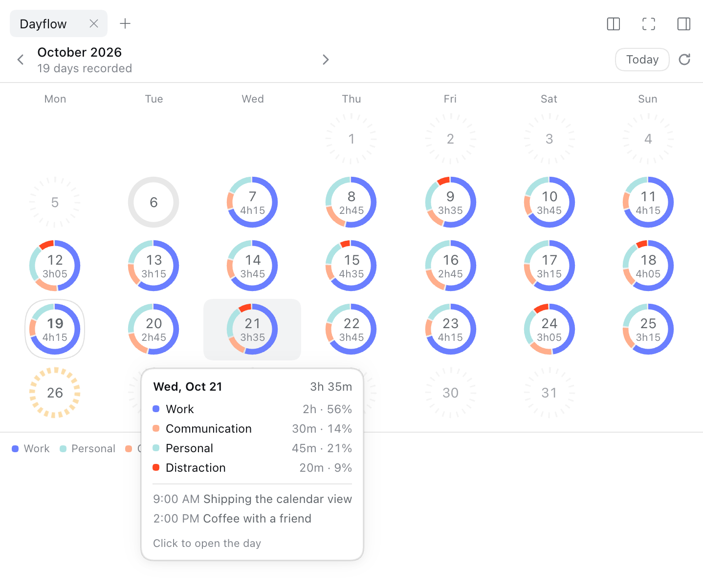
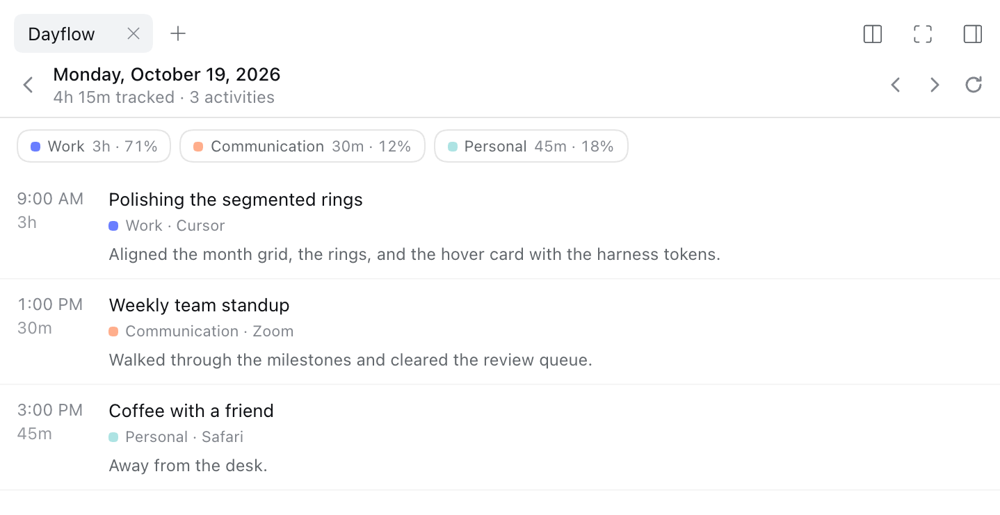

# dsh-plugin-dayflow

[](https://github.com/tailong-wu/dsh-plugin-dayflow/actions/workflows/ci.yml)
[](LICENSE)
[](https://nodejs.org)

English | [中文](README.zh.md)

Ask your own work journal. This plugin gives [DeepSeek Harness](https://github.com/deepseek-ai/deepseek-harness)
(`dsh`) native tools and skills over [Dayflow](https://github.com/JerryZLiu/Dayflow),
the open-source Mac app that turns screen activity into a private timeline of
what you actually worked on.

> "What did I work on today?" · "Where did the week go?" · "Write my standup."

The plugin reads Dayflow's local SQLite database directly, so it works while
the Dayflow app is closed and nothing leaves the Mac. Edits are optional and go
through Dayflow's own permission switch and write socket.

> **Status:** early (`0.1.0`). The tools, skills, and panel work on macOS with
> Dayflow installed; expect the surface to keep moving.

## What you get

- **14 tools**, named `dayflow_*`: 8 read tools and 6 editing tools.
- **4 skills**: `dayflow`, `onboarding`, `standup`, and `weekly-review`.
- **An optional Web panel**: a month calendar of segmented rings, with hover
  cards and a per-day timeline, opened from a conversation-header button and
  drawn with the harness's own tokens.
- **A system-prompt section** stating the rules that make the data readable:
  the 4 AM day boundary, `Idle` and `System` handling, analysis lag, and the
  untrusted-content boundary.
- **Zero runtime dependencies** beyond `dsh` itself: SQLite comes from
  `node:sqlite`, and the write channel is a Unix socket.

## Requirements

| Requirement | Notes |
| --- | --- |
| macOS | Dayflow is a Mac app; its data lives in `~/Library/Application Support/Dayflow`. |
| [Dayflow](https://dayflow.so) installed and recording | Grant screen-recording permission and pick an AI provider (local or cloud) in the app. |
| Node.js ≥ 22.5 | Node 22.5–23.3 need `--experimental-sqlite`; Node 24 has it built in. |
| `dsh` ≥ 0.2.0-rc.2 | The plugin peers on the 0.2 line of the harness. |
| `pnpm` on `PATH` | Only for `dsh plugin add`; a linked development install does not need it. |

## Install

```sh
# Once the package is published to a registry:
dsh plugin --profile web add dsh-plugin-dayflow
```

Until then, use the checkout install below. The plugin ships a bundle patch, so installing it selects the bundle. With HMR
enabled (the default for base-backed profiles) the running app reloads and the
tools appear in the next session. Then ask:

```text
What did I get done today?
Where did my time go this week?
Turn yesterday into a standup.
```

### Install from a checkout

```sh
git clone https://github.com/tailong-wu/dsh-plugin-dayflow.git
cd dsh-plugin-dayflow
npm install && npm run build

# Link it into the profile and record the bundle selection.
mkdir -p ~/.dsh/profiles/web/node_modules
ln -sfn "$PWD" ~/.dsh/profiles/web/node_modules/dsh-plugin-dayflow
```

Add `"dsh-plugin-dayflow"` to `dsh.profile.bundles` in
`~/.dsh/profiles/web/package.json` (and, optionally, a
`"dsh-plugin-dayflow": "link:<path>"` dependency entry). Rebuild with
`npm run build` after source changes; HMR reloads the profile.

To remove it, delete the symlink and the bundle entry.

## Web panel

The plugin can also draw the month inside the DSH Web GUI. The panel is optional
in both senses: nothing appears until you open it, and a profile can switch its
entry point off entirely.



- Open it from the **Dayflow** button in the conversation header. It collapses to
  an icon when the header runs out of room.
- Every day is one segmented ring: each arc is a category, sized by its share of
  the day and drawn in the user's own colours. The centre shows the date and the
  tracked time.
- **A day's state is never faked.** A day with no captures draws only a faint
  dotted track; a captured day with nothing to show draws a plain track; a day
  whose analysis is still queued pulses amber; a recorded day draws its arcs.
  Missing data is not zero activity.
- Hovering a day shows its total, category split, and the two longest activities;
  hovering one arc shows that category's name, duration, and share. The card
  clamps to the viewport and flips above the anchor near the bottom edge.
- Clicking a day opens it: totals, filter chips, and the timed activity list.
  Clicking a chip filters the list; **Clear filter** restores it.



- In the day view, `‹`/`›` step days, `⟳` refreshes, and the back arrow (or
  Escape) returns to the calendar with that day still marked as selected.
- On touch devices hover is replaced by tap: a tap opens the day, and the back
  control sits in the day header.
- The panel reads `GET /api/dayflow/month` and `GET /api/dayflow/day` through the
  harness's authenticated `/api` bridge. It never touches the database itself.

Set `panel: false` to remove both the header button and the tab type.

## Tools

Every tool returns structured JSON and renders the same data as compact text.
Dates are `YYYY-MM-DD` and mean a Dayflow day, which starts at **4 AM**.

### Read tools

| Tool | Arguments | Answers |
| --- | --- | --- |
| `dayflow_timeline` | `date?` | What happened on one day, with record IDs. |
| `dayflow_activity` | `record_id` | One activity in full, including its long write-up. |
| `dayflow_breakdown` | `from`, `to` | Time per category over a range, with shares. |
| `dayflow_search` | `query`, `limit?` | Activities whose title or summary matches. |
| `dayflow_daily` | `date?` | The Daily standup Dayflow generated. |
| `dayflow_weekly` | `date?` | Tracked and focus minutes plus category totals for a week. |
| `dayflow_categories` | — | The user's categories, colors, and flags. |
| `dayflow_status` | — | Capture freshness, analysis backlog, edit switch, edit-bridge state. |

### Editing tools

These are registered by default and can be switched off with `edits: false`.
Every call is checked against Dayflow's live **Settings → AI Tools → Allow
edits** switch, so a disabled switch produces an actionable error instead of a
stale tool list.

| Tool | Arguments | Effect |
| --- | --- | --- |
| `dayflow_update_activity` | `record_id`, `title?`, `category?` | Retitle or recategorize one activity. |
| `dayflow_delete_activity` | `record_id` | Delete an activity and its observations. Destructive. |
| `dayflow_create_category` | `name`, `color?`, `description?` | Add a category. |
| `dayflow_update_category` | `name`, `new_name?`, `color?`, `description?` | Rename, recolor, or describe. |
| `dayflow_delete_category` | `name` | Delete a category. Destructive. |
| `dayflow_set_goal` | `date?`, `focus_minutes`, … | Set a day's focus target and limits. |

### Mapping from Dayflow's own MCP server

If you used Dayflow's `dayflow mcp` server, the tools are the same operations
under a `dayflow_` prefix:

| This plugin | Dayflow MCP |
| --- | --- |
| `dayflow_timeline` | `get_timeline` |
| `dayflow_activity` | `get_activity_detail` |
| `dayflow_breakdown` | `get_time_breakdown` |
| `dayflow_search` | `search_activities` |
| `dayflow_daily` | `get_daily` |
| `dayflow_weekly` | `get_weekly` |
| `dayflow_categories` | `list_categories` |
| `dayflow_status` | `get_status` |
| `dayflow_update_activity` | `update_activity` |
| `dayflow_delete_activity` | `delete_activity` |
| `dayflow_create_category` | `create_category` |
| `dayflow_update_category` | `update_category` |
| `dayflow_delete_category` | `delete_category` |
| `dayflow_set_goal` | `set_day_goal` |

## Skills

| Skill | Use it for |
| --- | --- |
| `dayflow` | Routing: which tool answers which question, and the data conventions. |
| `onboarding` | Checking that Dayflow is installed, recording, and producing data. |
| `standup` | Drafting a standup or daily update from the timeline. |
| `weekly-review` | Reviewing a week and comparing it with the one before. |

Skills are registered at runtime from `skills/`, so installing the plugin is
enough; no skills root needs configuring.

## How it works

```text
dsh  ──tools──▶  dsh-plugin-dayflow  ──read──▶  chunks.sqlite (read-only, WAL)
                              │
                              └──write──▶  Dayflow.app over agent.sock
```

- **Reads** open `chunks.sqlite` with `readOnly: true` and `PRAGMA query_only`,
  so a bug in this plugin cannot damage the journal. A short busy timeout rides
  out the app's WAL checkpoints.
- **Writes** are one JSON line over Dayflow's Unix socket
  (`agent.sock`), because the app owns the category store and must refresh its
  UI. The protocol and the edit switch are Dayflow's, not this plugin's.
- **Categories** live in the app's preferences
  (`teleportlabs.com.Dayflow`, key `colorCategories`), not in SQLite. They are
  read with `defaults export` and parsed from the plist.
- **Day boundaries** mirror the app: a day is 4 AM to 4 AM local time, and a
  week is Monday 4 AM to Monday 4 AM, so late-night work lands on the day it
  belongs to.
- **Totals** leave out the `System` category; `focus_minutes` additionally
  leaves out `Idle`.

### Differences from Dayflow's own CLI and MCP server

- No MCP transport and no Swift binary: the plugin is plain Node and reads the
  database itself.
- Editing tools are always registered (with `edits: true`) and rejected at call
  time, instead of disappearing from `tools/list` when the user disables edits.
  Users who want them gone can set `edits: false`.
- Search escapes `%` and `_`, so a query is literal text rather than a SQL
  pattern.
- Impossible dates such as `2026-02-30` are rejected instead of being rolled
  over.
- Failures carry a stable code: `no_data`, `edits_disabled`, `app_not_running`,
  `not_found`, `invalid_input`, `database_error`, or `bridge_error`.

## Configuration

Set these under the plugin's row in a profile patch, or through the shipped
defaults in `cordis.patch.yml`:

```yaml
- id: dayflow
  config:
    databasePath: ''   # default: ~/Library/Application Support/Dayflow/chunks.sqlite
    agentSocket: ''    # default: agent.sock beside the database
    edits: true        # register the six editing tools
    skills: true       # register the four bundled skills
    searchLimit: 50    # maximum matches per dayflow_search call (1-200)
```

`DAYFLOW_DB` also overrides the database path when `databasePath` is empty.
`databasePath` and `agentSocket` exist for tests and unusual installs; leave
them empty in normal use.

## Privacy and safety

- Dayflow's data never leaves the Mac through this plugin. It opens one local
  SQLite file read-only and one local Unix socket.
- Screen-derived text (titles, summaries, write-ups) is data. The tool
  descriptions and the system-prompt section say so, so a model cannot be
  talked into following instructions that appear inside an activity title.
- Deletions also remove the underlying observations and cannot be fully undone.
  The tool descriptions require confirmation first.
- The plugin cannot enable Dayflow's edit switch; only the user can, in the app.

## Development

```sh
npm install
npm run build       # TypeScript → lib/, with .d.ts files
npm test            # 78 tests: boundaries, SQL, tools, bridge, panel, bundle
npm run typecheck   # type-check sources and tests together
npm run smoke       # read this Mac's real Dayflow database (needs real data)
```

`npm run smoke` prints status, today's timeline, a seven-day breakdown, the
week, and the categories from the live database; pass a date to inspect another
day.

### Layout

```text
src/
  index.ts        plugin entry: name, inject, Config, apply()
  config.ts       schema + validation
  day.ts          4 AM days, Monday 4 AM weeks, formatting
  db.ts           lazy node:sqlite, read-only open, query helper
  queries.ts      SQL reads and the stable JSON payloads
  categories.ts   preferences → categories and the edit switch
  bridge.ts       Unix-socket write client
  format.ts       model-facing text renderers
  skills.ts       SKILL.md loading and runtime registration
  prompt.ts       the guidance section
  panel.ts        the three host Fetch routes behind the Web panel
  panel-contract.ts  the wire payloads shared by host and browser
  tools/read.ts   the eight read tools
  tools/write.ts  the six editing tools
  client/         the browser half: month calendar, day detail, rings, styles
skills/           SKILL.md per skill, shipped in the npm package
tests/            node:test suite with a fixture database and a fake socket
scripts/smoke.mjs real-data smoke test
```

`lib/client.js` is not compiled by `tsc`: `scripts/build-client.mjs` bundles
`src/client/` with esbuild and wraps the CommonJS body in the harness's
`window.__ModuleLoader__.load({ id, factory })` registration, resolving `react`,
`react/jsx-runtime`, and `@deepseek-ai/dsh-client-ui-primitives` against the
browser shell's frozen platform table. `tests/client-bundle.test.ts` runs that
bundle in a VM with stubbed platform modules, so the registration contract is
tested without a browser.

The fixture database in `tests/fixtures/database.ts` reproduces the app's
schema and the cases that are easy to get wrong: a card after midnight, a
soft-deleted card, `System` time, and metadata with apps and distractions. The
bridge tests run a real Unix socket server, so the protocol is exercised end to
end.

## Troubleshooting

| Symptom | Fix |
| --- | --- |
| `No Dayflow database at …` | Open Dayflow, finish onboarding, record for a few minutes. |
| `Editing is off…` | Dayflow → Settings → AI Tools → Allow edits. |
| `Dayflow isn't running…` | Edits need the app open; reads do not. |
| `This Node.js (…) has no built-in SQLite` | Use Node 24+, or run Node 22.5–23.3 with `--experimental-sqlite`. |
| Time looks missing | Dayflow analyzes recordings in batches; `dayflow_status` shows the backlog. |
| Times are off by hours | The plugin uses the Mac's local timezone; check `dayflow_status`'s `time_zone`. |
| No Dayflow button in the header | Open a session first; the header is session-scoped. After installing or rebuilding, restart `dsh web` so the client bundle is served. |
| The panel says it cannot reach the server | The dsh process restarted or the session expired; reload the page. |

## License

MIT. This project ports Dayflow's agent surface and is not affiliated with the
Dayflow project. Dayflow is MIT-licensed, © 2025 Jerry Liu; see
[LICENSE](LICENSE) for the attribution covering the adapted skills and tool
contracts.
